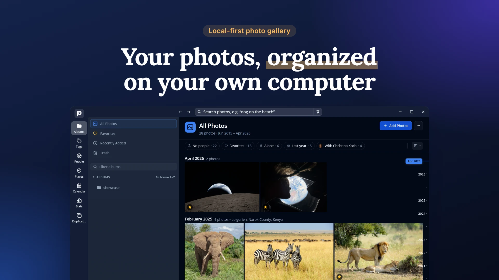
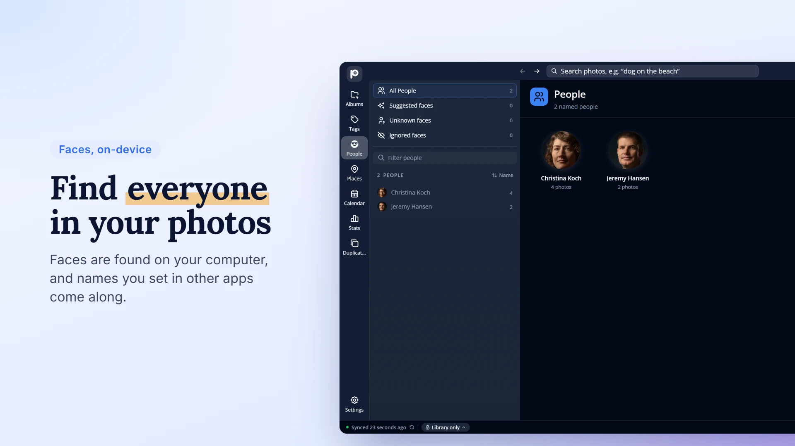
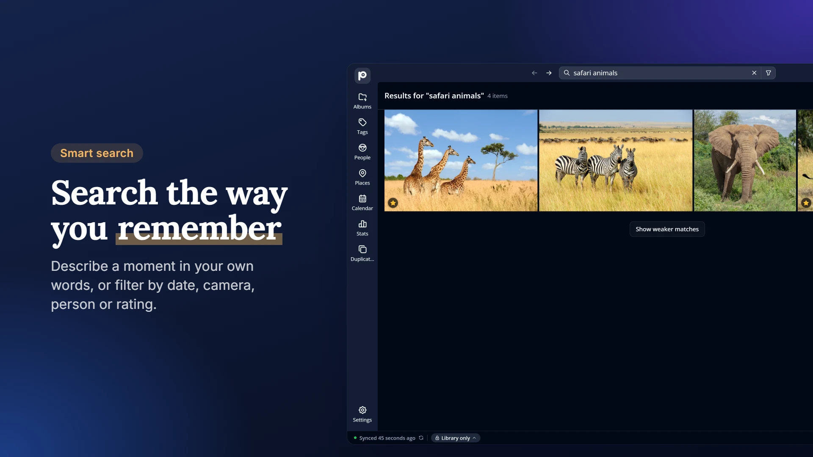
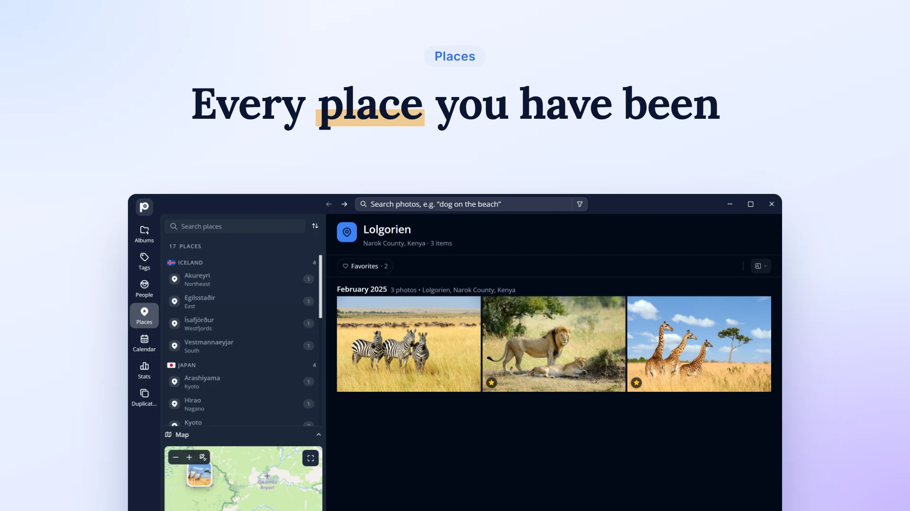
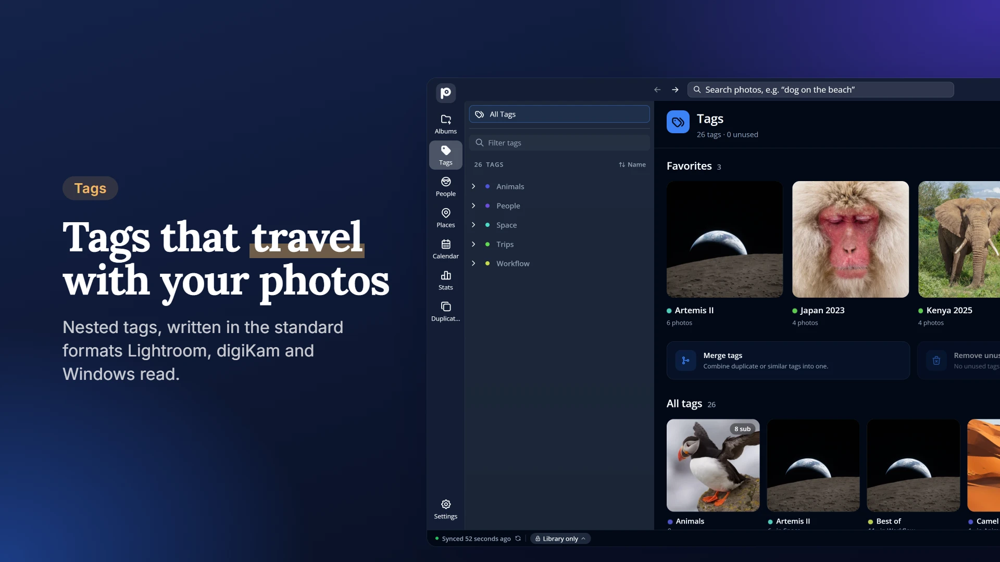
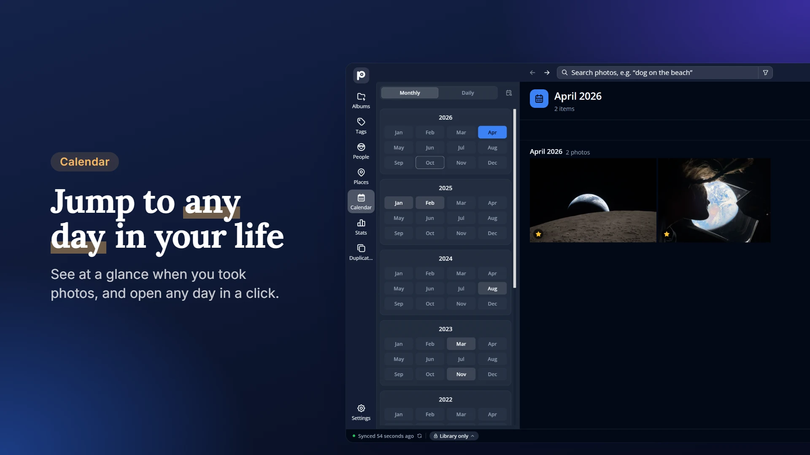
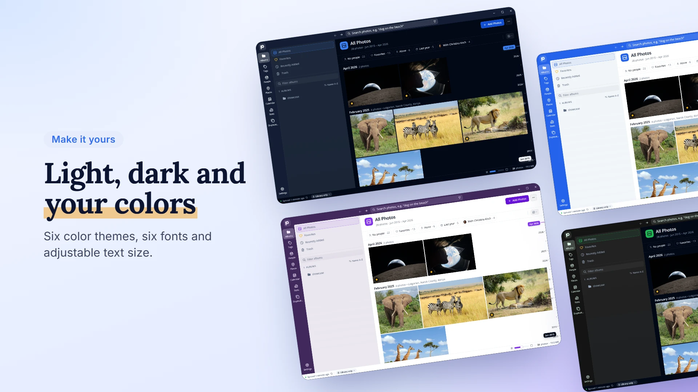

<!-- PROJECT LOGO -->
<br />
<div align="center">
  <a href="https://enrique-lozano.github.io/Photokin/">
    
  </a>

  <h1 align="center">Photokin</h1>

  <p align="center">
    <strong>Your photos, organized on your own computer.</strong>
    <br />
    A free, open-source, local-first photo gallery for Windows and macOS.
    <br />
    No account, no cloud, no tracking: faces and smart search run on your device.
    <br />
    <br />
    <a href="https://github.com/enrique-lozano/Photokin/releases/latest"><strong>Download »</strong></a>
    &nbsp;·&nbsp;
    <a href="https://enrique-lozano.github.io/Photokin/">Website</a>
    &nbsp;·&nbsp;
    <a href="https://enrique-lozano.github.io/Photokin/guide/">User guide</a>
    &nbsp;·&nbsp;
    <a href="https://github.com/enrique-lozano/Photokin/issues">Report a bug</a>
    <br />
    <br />
    <a href="https://github.com/enrique-lozano/Photokin/releases/latest"></a>
    
    <a href="LICENSE"></a>
  </p>
</div>

<!-- TABLE OF CONTENTS -->
<details>
  <summary>Table of contents</summary>
  <ol>
    <li>
      <a href="#about-the-project">About the project</a>
      <ul>
        <li><a href="#-screenshots">Screenshots</a></li>
        <li><a href="#-why-photokin">Why Photokin?</a></li>
        <li><a href="#-local-first-with-clear-online-boundaries">Local-first, with clear online boundaries</a></li>
        <li><a href="#-tech-stack">Tech stack</a></li>
      </ul>
    </li>
    <li><a href="#getting-started-">Getting started</a></li>
    <li><a href="#run-the-code-locally-">Run the code locally</a></li>
    <li>
      <a href="#contributing-">Contributing</a>
      <ul>
        <li><a href="#documentation">Documentation</a></li>
        <li><a href="#support-the-project-">Support the project</a></li>
      </ul>
    </li>
    <li><a href="#license">License</a></li>
  </ol>
</details>

## About the project

> [!NOTE]
> Photokin is young software, preparing its first releases. Try it with copies
> of your photos, keep backups, and tell us what breaks.

### 📸 Screenshots

|                                                                                      |                                                                            |
| :----------------------------------------------------------------------------------: | :------------------------------------------------------------------------: |
|          |        |
|                            |         |
|                               |    |
|  |  |

<sub>Demo photos by NASA and Wikimedia Commons photographers, see [credits](demo/showcase/ATTRIBUTION.md).</sub>

### 🌟 Why Photokin?

- **📁 Your folders stay yours.** Photokin indexes photos where they are. Nothing is copied, moved or locked into a proprietary library.
- **🗓️ Browse your way.** A timeline grouped by day, month or year, a calendar, a map of every place you've been, and stats about how you shoot.
- **🙂 Faces, recognized locally.** Find the people in your photos, review suggestions, and name everyone without uploading a single image.
- **✨ Smart search.** Type _"dog on the beach"_ to search by what's in a photo, or combine precise filters like `person:Ana rating>=4 year=2023`.
- **🏷️ Tags that travel.** Nested tags, ratings, descriptions, dates and places, written in the standards Lightroom, digiKam and Windows read (EXIF, IPTC, XMP).
- **🧹 Clean up with confidence.** Find exact duplicates, look-alikes and bursts, and review before anything goes to Trash.
- **✂️ Quick edits.** Crop, rotate, flip and resize, then save a copy or explicitly replace a supported original.
- **🧑‍🔬 Simple for everyone, deep for experts.** No metadata knowledge needed, yet every raw EXIF/IPTC/XMP value is one click away.
- **🔓 Free and open source.** No subscription, no ads, no tracking.

### 🔒 Local-first, with clear online boundaries

Your library, faces and search index stay on your computer. A few optional
features use the internet: map tiles, elevation lookups, downloading a search
model or ExifTool, and checking for updates. The
[privacy page](https://enrique-lozano.github.io/Photokin/guide/privacy) lists
every connection and what it reveals.

By default your edits stay in Photokin's library and **your files are never
touched** by them. You choose if and when tags, ratings and other details are
written into the photos themselves. See
[Photo metadata](https://enrique-lozano.github.io/Photokin/guide/metadata) and
[Photo safety](docs/PHOTO_SAFETY.md).

### 🛠 Tech stack

- **[Tauri 2](https://v2.tauri.app/) + Rust** for the desktop shell and native work: thumbnails, hashing, image edits, filesystem.
- **React + TypeScript**, with Tailwind and Radix-based UI primitives.
- **SQLite + [Kysely](https://kysely.dev/)** for the local library, with live queries and Zustand for UI state.
- **[ExifTool](https://exiftool.org/)** for metadata, **FFmpeg** for video and HEIC previews.
- **On-device models:** YuNet + SFace for faces and CLIP/SigLIP for smart search, run through ONNX sidecars.

## Getting started 🚀

Download the installer for **Windows 10/11 (64-bit)** or **macOS (Apple
silicon)** from the [latest release](https://github.com/enrique-lozano/Photokin/releases/latest),
then follow the [install guide](https://enrique-lozano.github.io/Photokin/guide/getting-started).
Photokin updates itself when a new version is published.

New to Photokin? The [user guide](https://enrique-lozano.github.io/Photokin/guide/)
covers everything from adding your first folder to
[building a good tag tree](https://enrique-lozano.github.io/Photokin/guide/tags).

## Run the code locally 🧑‍💻

Follow the [local setup guide](docs/RUN_THE_CODE_LOCALLY.md) for the native
toolchain, Python sidecars and ExifTool. Once the prerequisites are installed:

```powershell
pnpm install
pnpm run tauri dev
```

The first start downloads or builds the missing sidecars and can take a few
minutes. Photokin is a desktop app; running Vite alone doesn't give you a
working browser version.

## Contributing 🙋

Bug reports, ideas, documentation, design feedback and code are all welcome,
and you don't need to be a developer. Start with the
[contribution guide](CONTRIBUTING.md), or go straight to the
[developer guide](docs/CODE_CONTRIBUTING.md).

> [!IMPORTANT]
> Photos can hide GPS coordinates, names and face regions in their metadata.
> Please use sanitized or public-domain samples when reporting problems.

### Documentation

| For         | Read                                                                                                                                                                 |
| ----------- | -------------------------------------------------------------------------------------------------------------------------------------------------------------------- |
| Users       | [User guide](https://enrique-lozano.github.io/Photokin/guide/) · [Privacy and network access](docs/PRIVACY_POLICY.md) · [Photo safety](docs/PHOTO_SAFETY.md)         |
| Developers  | [Run locally](docs/RUN_THE_CODE_LOCALLY.md) · [Code and architecture](docs/CODE_CONTRIBUTING.md) · [Testing](docs/TESTING.md) · [Sidecar scripts](scripts/README.md) |
| Maintainers | [Screenshots](screenshots/README.md) · [Website](website/)                                                                                                           |

### Support the project 💖

Photokin is built in the open and kept going by people like you. If it's useful
to you, an optional donation helps a lot:

<p>
  <a href="https://paypal.me/lozanoelc?country.x=ES&locale.x=es_ES"></a>
  <a href="https://www.buymeacoffee.com/enrique.lozano"></a>
  <a href="https://liberapay.com/enrique-lozano/donate"></a>
</p>

Payments happen on those services, never inside Photokin. Reporting bugs,
improving the docs and sharing feedback are equally valuable ways to help.

## License

Photokin is free software under the [GNU AGPL-3.0-only](LICENSE) license. The
maintainer also offers commercial licensing. Contributions are accepted under
the [Contributor License Agreement](CLA.md).

<div align="center">
  <br />
  <sub>Made with care. Kept going by you. 💛</sub>
</div>
